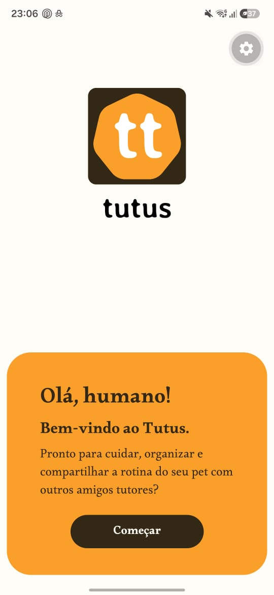
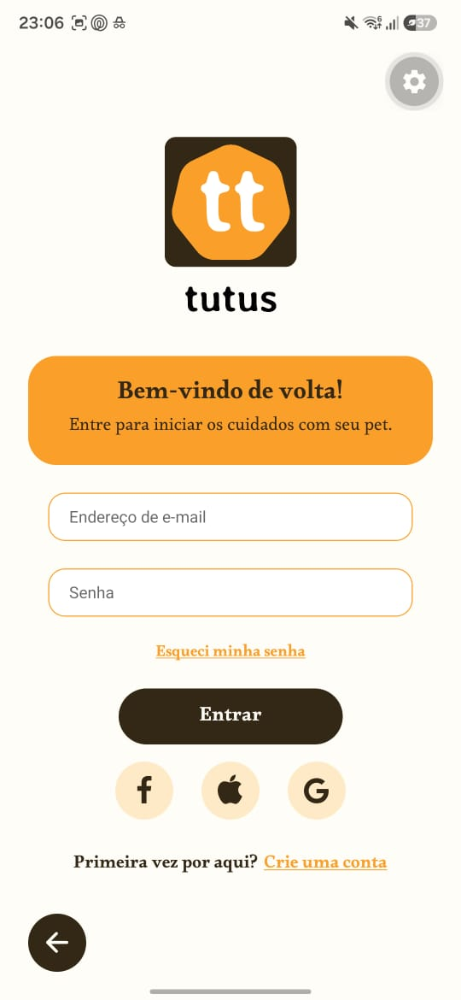
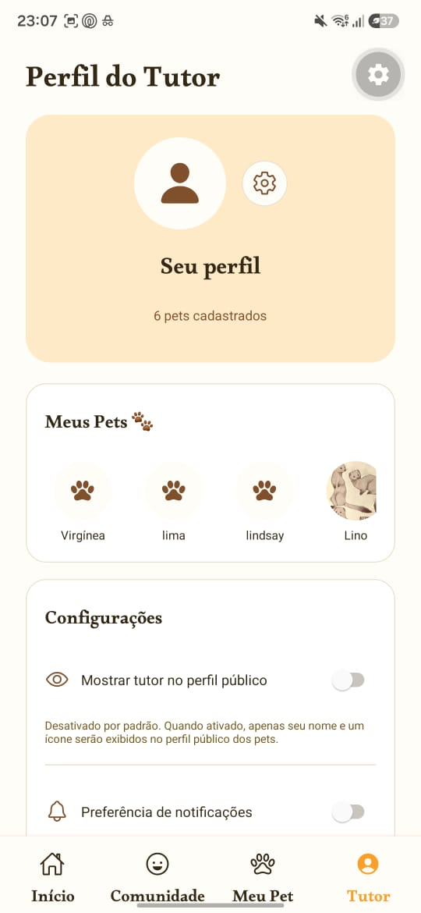

    

# Tutus 🐾

O **Tutus** é o aplicativo móvel idealizado para este projeto acadêmico, voltado para tutores de animais de estimação e visando reunir, em um único ambiente, recursos para a organização dos cuidados dos pets e a interação entre tutores.

## Sobre o projeto

O **Tutus** está sendo desenvolvido como parte de um projeto acadêmico voltado para o desenvolvimento de aplicações móveis, tendo como principal ferramenta a ser o usada o *React Native*. A proposta é criar um ambiente que auxilie na organização da rotina e no acompanhamento dos principais cuidados relacionados aos animais de estimação.

O aplicativo está sendo planejado para permitir o registro e acompanhamento de informações como peso, alimentação, vacinas, consultas e medicamentos, mantendo esses dados em uma área privada destinada ao gerenciamento de cada animal. Com isso, busca-se facilitar a organização dessas informações e torná-las mais acessíveis no dia a dia do tutor.

Além da área de gerenciamento, o projeto prevê uma comunidade dedicada ao universo pet, na qual os tutores poderão compartilhar momentos e conteúdos relacionados aos seus animais e interagir com outros usuários. Dessa forma, o **Tutus** busca unir organização dos cuidados e interação social em uma mesma aplicação.

A proposta também busca minimizar problemas como a desorganização das informações relacionadas aos cuidados dos pets, dificuldade para acompanhar e registrar dados importantes, o excesso de conteúdos variados presentes nas redes sociais tradicionais e a falta de um espaço de interação dedicado exclusivamente ao universo pet.

## Funcionalidades Implementadas

- Telas Splash Screen, Welcome, Login, Criar Conta e Recuperação de Senha, com validações básicas, autenticação demonstrativa e estrutura básica.
- Navegação entre as principais telas e abas em desenvolvimento utilizando React Navigation;
- Estrutura de navegação inferior com as abas Início, Comunidade, Meu Pet e Tutor;
- Perfil do Tutor com visualização dos pets cadastrados e estrutura inicial de configurações e privacidade.
- Comunidade com feed básico, perfil público do pet e publicações locais de fotos e legendas;
- Perfil privado do pet com registro e gerenciamento de alimentação, peso, vacinas, consultas e medicamentos;
- Cadastro de um ou mais pets;
- Lista de seleção dos pets;
- Cadastro, listagem e seleção de pets, com validação de campos e armazenamento local via AsyncStorage;
- Persistência dos dados individuais de cada pet, permitindo recuperá-los após reiniciar o aplicativo;
- Home com resumo dos cuidados, gráficos de acompanhamento, previsão de refeições e lembretes (Ainda em fase de experimentação);

  
  
  

  <em>Boas-vindas • Login • Perfil do Tutor</em>

## Funcionalidades planejadas

- Implementação da autenticação real de usuários e recuperação de senha por e-mail;
- Aprimoramento do perfil público do pet e da experiência na Comunidade;
- Publicações de vídeos e interação entre tutores de diferentes dispositivos;
- Implementação de uma comunidade com compartilhamento remoto de publicações;
- Personalização geral do tema do aplicativo;
- Finalização das informações da conta, privacidade e personalização do Perfil do Tutor;
- Edição e exclusão dos pets cadastrados;
- Integração com serviços remotos para armazenamento e compartilhamento de dados;
- Aprimoramento das interfaces, design e experiência de navegação.

## Tecnologias utilizadas (até o momento)

- React Native.
- Expo.
- JavaScript.
- Git & Github.

## Status do projeto

**Em desenvolvimento.**

## Equipe 👩‍💻

- Éveny Oliveira.
- Isabele Moura.

---

  Projeto acadêmico desenvolvido para a disciplina de Programação para
  Dispositivos Móveis em Android.

